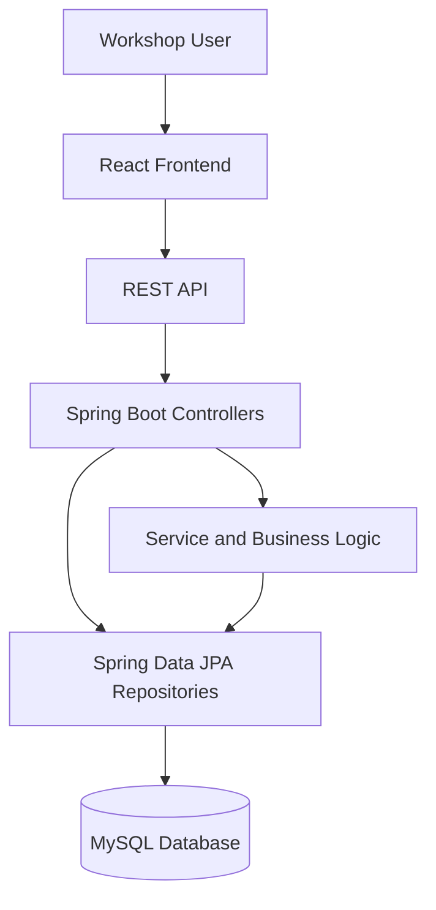

# Gamini Auto Workshop Management System


## Project Overview

Gamini Auto Workshop Management System is a full-stack
web application designed to digitize the daily operations
of an automotive electrical repair and spare-parts business.

The project is based on the real-world operational needs
of Gamini Auto Electricals & Motors in Sri Lanka.

It aims to replace manual record keeping with a centralized,
efficient and scalable workshop management platform.

## Business Objectives

- Centralize customer and vehicle records.
- Manage automotive repair jobs and service history.
- Track repair charges, outstanding balances and warranties.
- Manage spare-parts inventory and stock transactions.
- Reduce manual paperwork and improve operational efficiency.
- Support future business growth through modular architecture.

## Current Features

### Customer Management

- Customer registration
- Customer record management
- Search, update and delete operations

### Vehicle Management

- Vehicle registration
- Customer and vehicle relationships
- Vehicle information management
- Search and update operations

### Job Card Management

- Vehicle repair and component repair job cards
- Alternator and starter motor repair records
- Customer complaints and fault diagnosis
- Repair details and technician assignment
- Job status and priority management
- Labour charges and spare-parts costs
- Discounts and payment calculations
- Outstanding balance tracking
- Warranty management
- Job search and filtering

### Inventory Management

- Spare-parts registration
- SKU and part-number management
- Product categories and specifications
- Purchase, retail and wholesale prices
- Estimated unit profit
- Low-stock and out-of-stock indicators
- Product activation and deactivation
- Estimated inventory valuation

### Stock Movement Management

- Stock-in and stock-out transactions
- Customer returns
- Supplier returns
- Stock adjustments
- Stock movement history
- Insufficient stock validation
- Transactional stock updates
- Pessimistic database locking

## Technology Stack

| Layer | Technology |
|---|---|
| Frontend | React, Vite, JavaScript, CSS |
| Backend | Java 21, Spring Boot |
| Database | MySQL |
| ORM | Spring Data JPA, Hibernate |
| API | RESTful APIs |
| Build Tools | Maven, npm |
| Version Control | Git, GitHub |
| Development IDE | Visual Studio Code |

## System Architecture



## Project Structure

```text
gamini-auto-workshop-manager/
|-- backend/
|   |-- src/
|   |   |-- main/
|   |   |   |-- java/
|   |   |   |   +-- com/gaminiauto/workshopmanager/
|   |   |   |       |-- controller/
|   |   |   |       |-- entity/
|   |   |   |       |-- repository/
|   |   |   |       +-- service/
|   |   |   +-- resources/
|   |   +-- test/
|   +-- pom.xml
|-- frontend/
|   |-- public/
|   |-- src/
|   |   |-- assets/
|   |   |-- components/
|   |   |-- App.jsx
|   |   +-- App.css
|   +-- package.json
|-- .gitignore
+-- README.md
```

## Main API Endpoints

| Method | Endpoint | Description |
|---|---|---|
| GET | /api/customers | List customers |
| POST | /api/customers | Register customer |
| GET | /api/vehicles | List vehicles |
| POST | /api/vehicles | Register vehicle |
| GET | /api/jobcards | List repair jobs |
| POST | /api/jobcards | Create job card |
| GET | /api/products | List products |
| POST | /api/products | Register product |
| GET | /api/products/low-stock | List low-stock products |
| GET | /api/stock-movements | Stock movement history |
| POST | /api/stock-movements | Record stock movement |

## Getting Started

### Prerequisites

- Java Development Kit 21 or compatible version
- MySQL Server
- Node.js compatible with the project's Vite version
- npm
- Git

### 1. Clone the Repository

```bash
git clone https://github.com/janindu-gunasekara/gamini-auto-workshop-manager.git
cd gamini-auto-workshop-manager
```

### 2. Configure MySQL

Create a local development database and a dedicated database
user using a password of your choice.

```sql
CREATE DATABASE gamini_auto_db;
```

The default database username is `gamini_app`.
Create this user locally and grant the required permissions
on the development database, or update the datasource
username in application.properties.

### 3. Start the Backend

Windows PowerShell:

```powershell
cd backend

$secure = Read-Host "Enter database password" -AsSecureString
$env:DB_PASSWORD = [System.Net.NetworkCredential]::new("", $secure).Password

.\mvnw.cmd spring-boot:run
```

Backend URL: http://localhost:8080

### 4. Start the Frontend

Open a separate terminal from the project root.

```bash
cd frontend
npm ci
npm run dev
```

Open the local URL displayed by Vite.

## Development and Testing

The project has undergone manual development-stage testing.

| Test Area | Reported Result |
|---|---|
| Product API | 16/16 passed |
| Stock movement API | 19/19 passed |
| Inventory frontend integration | 9/9 passed |
| Existing module read regression | 8/8 passed |

These results represent manual development checks, not
a complete automated test suite.

Additional frontend, concurrency, security and end-to-end
testing is planned.

## Development Roadmap

- [x] Customer management
- [x] Vehicle management
- [x] Core job card management
- [x] Product and inventory management
- [x] Stock movement management
- [ ] Supplier management
- [ ] Purchase order management
- [ ] Job card and inventory integration
- [ ] Invoice generation
- [ ] Payment transaction management
- [ ] Income and expense management
- [ ] Financial reports and analytics
- [ ] User authentication and authorization
- [ ] Role-based access control
- [ ] Database migrations and backup management
- [ ] Production deployment

## Security and Development Status

Database credentials are supplied through environment variables.

This application is currently under active development.
Authentication and authorization are not yet implemented.

The current version is intended for local development and
portfolio demonstration, not production deployment or
processing real customer data.

## Author

**Janindu Gunasekara**

BSc (Hons) in Information Technology Undergraduate  
Sri Lanka Institute of Information Technology (SLIIT)

- GitHub: https://github.com/janindu-gunasekara
- LinkedIn: https://www.linkedin.com/in/janindu-gunasekara

## Project Status

**v0.1.0 - Initial Development Version**

This project is being developed incrementally as a practical
full-stack software engineering and business digitization project.

